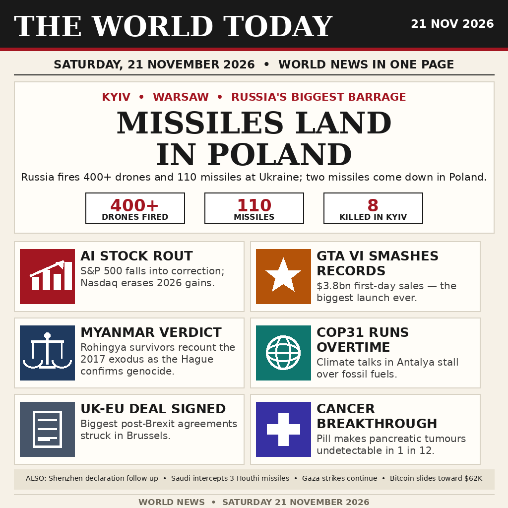

# World News, 21 November 2026

[](https://make.fun/bounty/news-image-20261121)
[](https://make.fun/bounty/news-image-20261121)
[](https://make.fun/bounty/news-image-20261121)

Entry for the [make.fun](https://make.fun/bounty/news-image-20261121) bounty
**news-image-20261121** — sum up the world's news of Saturday 21 November 2026
in one image.



## The day in one page

A one-page newspaper, drawn by `main.py` (Python 3.13, Pillow only, no
network, fully deterministic — two runs write identical bytes).

- **Hero — Missiles land in Poland:** Russia fires 400+ drones and 110
  missiles at Ukraine in its biggest barrage; two missiles come down in
  Poland, which calls it a deliberate provocation.
- **AI stock rout:** the S&P 500 falls into correction and the Nasdaq
  erases its 2026 gains as AI and chip shares sell off.
- **GTA VI smashes records:** $3.8bn in first-day sales, the biggest
  launch in history.
- **Myanmar verdict:** Rohingya survivors recount the 2017 exodus as the
  Hague court confirms the genocide ruling.
- **COP31 runs overtime:** climate talks in Antalya stall over fossil
  fuels.
- **UK-EU deal signed:** the biggest post-Brexit agreements are struck
  in Brussels.
- **Cancer breakthrough:** a pill makes pancreatic tumours undetectable
  in 1 in 12 patients.
- **Also:** the Shenzhen declaration follow-up, Saudi intercepts of
  Houthi missiles, Gaza strikes continue, and Bitcoin slides toward $62K.

## Run it

```sh
mkdir -p out && MAKEFUN_OUTPUT_DIR=out python3 main.py
```

Writes a 1024x1024 PNG to `out/entry.png` (about 121 KB, under the 1 MiB
limit).

## License

MIT — see [LICENSE](LICENSE).
